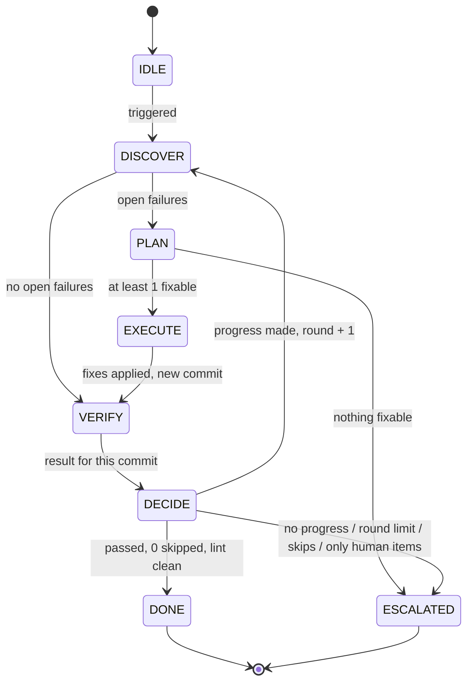

# ci-triage-loop

An agent loop for CI triage, built as an explicit state machine:
**DISCOVER → PLAN → EXECUTE → VERIFY → DECIDE**, ending in **DONE** or **ESCALATED**.

Every transition is checked against an allowed list and saved to `state.json`,
so the loop can resume after a crash and always leaves an audit log.

## States



## Rules

- VERIFY must test the exact commit EXECUTE produced.
- Skipped tests never count as a pass.
- No progress (none of last round's failures got fixed) means the loop escalates.
- A failed fix attempt, or a fixed test that breaks again, is reopened and retried.
- Hard limit of 5 rounds. Items stuck in `fixing` for over 48 hours are escalated.
- A step that throws 3 times in a row escalates.
- Lessons learned are passed into PLAN and EXECUTE.

## Quick start

Needs Python 3.9 or newer. No dependencies.

```bash
python examples/run_demo.py                 # simulated run
python -m unittest discover -s tests -v     # tests
```

## Connecting real CI

Write an adapter with these 5 methods and pass it to `Machine`:

| Method | Returns |
|---|---|
| `head()` | `(commit_sha, branch)` |
| `failing_tests(commit)` | `[(test_id, error), ...]` |
| `classify(item, lessons)` | `"fix"` or `"human"` |
| `apply_fixes(items, lessons)` | branch name per item (safe to parallelise) |
| `verify(commit)` | `{"commit", "passed", "skipped", "lint_clean", "failures"}` |

```python
from pathlib import Path
from ci_triage import Machine

state = Machine(MyCI(), Path("state.json"), "all tests pass + lint clean").run()
print(state.state, state.reason)
```

See `examples/fake_ci.py` for a working adapter.

## Layout

```
ci_triage/machine.py         state machine
examples/fake_ci.py          simulated CI adapter
examples/run_demo.py         demo run
tests/test_machine.py        unit tests
.github/workflows/tests.yml  GitHub Actions CI
```

## License

MIT
